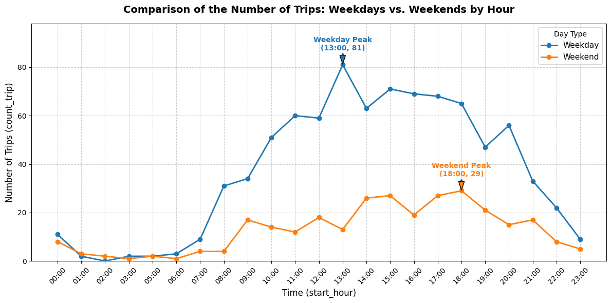

# Uber Trip Data Analysis

## 1. The Problem & Objectives
As a leader in the ride-hailing industry, efficiency and ride experience are the primary operational focuses for Uber. This analysis project has three key objectives:
* **Describe general trip patterns** through metrics such as total trips, daily averages, duration, and distance, segmented by user category and day type (weekday vs. weekend).
* **Identify peak hours** to understand service demand dynamics, including discovering the top 10 busiest days and hours.
* **Evaluate trip efficiency** based on average speed to locate potential bottlenecks and traffic congestion.

---

## 2. Data & Approach
* **Dataset**: Uber trip dataset consisting of 17 dimensions/columns and 1,141 rows. The dataset was already pre-cleaned, requiring no further data cleaning steps.
* **Analytical Approach**: Distance metrics were converted from miles to kilometers ($km$) and speed to $km/h$. Speed thresholds were categorized into three efficiency levels:
  * **Efficient**: $> 40 \text{ km/h}$
  * **Moderate**: $25 - 40 \text{ km/h}$
  * **Inefficient**: $< 25 \text{ km/h}$
* **Tech Stack**: SQL (Google BigQuery).

---

## 3. Results & Impact

### A. Trip Patterns by Category
Analyses were performed to understand trip behaviors by user category (*Business* vs. *Personal*) and day type (*Weekday* vs. *Weekend*).

| Category | Day Type | Total Trip | Avg Trip/Day | Avg Duration (Mins) | Avg Distance (Km) | Avg Speed (Km/h) |
| :--- | :--- | :---: | :---: | :---: | :---: | :---: |
| **Business** | Weekday | 796 | 3.79 | 22.64 | 29.74 | 71.29 |
| **Business** | Weekend | 270 | 3.55 | 23.76 | 29.75 | 66.94 |
| **Personal** | Weekday | 52 | 2.36 | 15.46 | 15.49 | 52.35 |
| **Personal** | Weekend | 23 | 2.30 | 31.78 | 44.53 | 58.30 |

**Key Insights:**
* **Business Trip Dominance**: Uber usage is overwhelmingly business-driven, peaking on Weekdays with 796 total trips (averaging 3.79 trips per day).
* **Consistent Business Distance**: The average trip distance for business trips remains extremely stable at $\approx 29.7 \text{ km}$, regardless of weekday or weekend operations.
* **Personal Trip Characteristics**: Personal trips on weekends have the lowest volume (23 trips), yet record the longest average distance ($44.53 \text{ km}$) and duration ($31.78 \text{ minutes}$).

---

### B. Peak Hours Identification

#### Hourly Trip Distribution (Weekday vs. Weekend)

**Key Insights:**
* **Weekday Peak**: Orders increase noticeably starting at 08:00 (31 trips) and reach an overall peak at 13:00 (81 trips).
* **Weekend Peak**: Demand is more evenly spread throughout the afternoon, reaching its highest volume at 18:00 (29 trips).

#### Top 10 Busiest Days & Hours

| Day | Start Hour | Count Trip |
| :--- | :---: | :---: |
| **Friday** | 13:00 | 24 |
| **Friday** | 11:00 | 24 |
| **Wednesday** | 17:00 | 18 |
| **Tuesday** | 17:00 | 18 |
| **Tuesday** | 13:00 | 18 |
| **Saturday** | 17:00 | 17 |
| **Sunday** | 18:00 | 17 |
| **Monday** | 14:00 | 17 |
| **Thursday** | 18:00 | 17 |
| **Friday** | 15:00 | 17 |

**Key Insights:**
* **Friday Peak**: Friday is the single busiest day, holding the top two spots at 13:00 and 11:00 (24 trips each).
* **Evening Rush Hour**: The 17:00 and 18:00 time slots consistently represent peak hours across almost all days of the week.

---

### C. Trip Efficiency Analysis

#### 1. Overall Efficiency Breakdown

| Day Type | Efficiency Category | Total Trip | Avg Duration (Mins) | Avg Distance (Km) | Avg Speed (Km/h) |
| :--- | :--- | :---: | :---: | :---: | :---: |
| **Weekday** | Efficient | 614 | 22.56 | 30.30 | 85.99 |
| **Weekday** | Moderate | 156 | 18.83 | 10.48 | 32.89 |
| **Weekday** | Inefficient | 78 | 26.05 | 8.05 | 20.27 |
| **Weekend** | Efficient | 214 | 26.72 | 39.01 | 79.93 |
| **Weekend** | Moderate | 58 | 18.88 | 10.23 | 32.64 |
| **Weekend** | Inefficient | 21 | 16.00 | 5.36 | 20.44 |

#### 2. Hours with Highest Inefficiency Rate

| Day Type | Start Hour | Inefficient Trips | Total Trips | Inefficient % |
| :--- | :---: | :---: | :---: | :---: |
| **Weekday** | 16:00 | 12 | 69 | **17.39%** |
| **Weekday** | 13:00 | 12 | 81 | **14.81%** |
| **Weekday** | 19:00 | 6 | 47 | **12.77%** |
| **Weekday** | 14:00 | 8 | 63 | **12.70%** |
| **Weekday** | 15:00 | 7 | 71 | **9.86%** |
| **Weekend** | 13:00 | 3 | 13 | **23.08%** |
| **Weekend** | 15:00 | 4 | 27 | **14.81%** |
| **Weekend** | 10:00 | 2 | 14 | **14.29%** |
| **Weekend** | 17:00 | 3 | 27 | **11.11%** |

#### 3. Top Inefficient Trip Purposes

| Day Type | Purpose | Inefficient Trips | Total Trips | Inefficient % |
| :--- | :--- | :---: | :---: | :---: |
| **Weekday** | Temporary Site | 20 | 155 | **12.90%** |
| **Weekday** | Meal/Entertain | 22 | 180 | **12.22%** |
| **Weekend** | Errand/Supplies | 8 | 50 | **16.00%** |
| **Weekend** | Meeting | 9 | 85 | **10.59%** |

**Key Insights:**
* **Efficiency Overview**: The majority of trips run smoothly (speeds $> 40 \text{ km/h}$)[cite: 12]. Inefficient trips drop to an average speed of $\sim 20 \text{ km/h}$ despite having shorter average distances.
* **Peak Congestion Windows**: On weekdays, 16:00 has the highest proportion of bottlenecked trips (17.39%)[cite: 13]. On weekends, 13:00 sees the highest inefficiency rate (23.08%).
* **Most Impacted Purposes**: Weekday business travel to *Temporary Sites* (12.90%) and *Meal/Entertain* (12.22%) encounter the most traffic delays[cite: 14], whereas weekend trips for *Errand/Supplies* experience a 16.00% inefficiency rate.
